# PPT-design-system

Extract a reusable design pack from a reference presentation, then use it to make a new deck. This is a cross-tool preview for coding agents with local file and shell access.

把参考演示提炼成可复用的设计包，再用同一套设计做新稿。可以从 PPTX、PDF、截图或 Markdown 设计规范开始，交付可编辑 HTML、原生 PPTX 和 16:9 PDF。第一次使用，建议准备一份参考和一份短文稿。

**[打开操作指南](docs/usage.md)** · 按模式找入口，或跟着示例从参考稿做到可编辑 PPTX 和 PDF。

## How it works · 工作流程

从参考稿提取一份可复用设计包。有了设计包，新稿可以直接从 Reuse 开始。选版遇到缺口或出现多个候选时，先看匹配报告，再调整并重试。



[查看中文版大图](docs/images/workflow.zh-CN.svg) · [View the full-size English diagram](docs/images/workflow.en.svg)

<details>
<summary>English workflow diagram</summary>

Extract a reusable design pack from a reference, then start from Reuse each time you bring a new manuscript. If a page has no match or several candidates, review the match report before retrying.


</details>

## Quick start · 快速开始

1. Clone or download this repository and open it in your agent's workspace.
2. Set up Python 3.11 and install the [runtime dependencies](ppt-design-system/references/workflow.md).
3. Ask the agent to read [the Skill](ppt-design-system/SKILL.md). For a tool that supports installed skills, copy the whole `ppt-design-system/` folder into its skills directory and invoke `$ppt-design-system`.

> Read `ppt-design-system/SKILL.md`. Extract a design pack from my reference PPTX. Then use the pack and my manuscript to produce a five-slide HTML deck. Report any page that needs a layout extension.

也可以直接把参考和文稿交给 Codex，用下面这段话开始。

> 用 `$ppt-design-system` 从参考稿提取设计包，再把已确认文稿做成一份 6–8 页的演示。保留原文中的事实和数字，告诉我哪些页面可直接套版、哪些需要延展。交付一个可以改字、换图、拖动组件的编辑入口，我要从里面下载 PPTX 和 PDF。

## Usage · 使用方式

| 你想做什么 | 准备什么 | 会得到什么 |
| --- | --- | --- |
| **Extract · 提取风格** | 参考 PPTX、PDF 或截图，以及未来常做的演示类型 | 素材清单、组件覆盖表和经审阅的设计包 ZIP。设计包记录颜色、字阶、版式、内容槽、选中的素材及来源。 |
| **Extract · 读取设计规范** | `design.md` 等 Markdown 文件；有参考画面时一并提供 | Agent 辅助映射的设计包，区分文档声明、解释、延展和缺口。Markdown 不经过视觉扫描器。 |
| **Reuse · 选版和填槽** | 已有设计包和新文稿 | 逐页分镜、版式匹配结果和具体缺口。可先确认分镜，再生成成稿。 |
| **Make · 制作与交付** | 已有设计包、确认后的文稿，以及需要替换进去的图片 | 可编辑 HTML 和支持原生对象的 PPTX。打开本机编辑入口后，可直接下载当前稿的 PPTX 或 PDF。 |

首次提取时，扫描会先登记可获取的素材和来源证据。Agent 结合页面预览确认素材角色、版式和组件覆盖，再整理成可复用的设计包。后续换稿可沿用同一个设计包。 [提取与打包说明](ppt-design-system/references/workflow.md#自动生成素材清单和覆盖表)

也可提供 `design.md` 设计规范，由 Agent 区分明确声明、解释和新增延展，映射成现有设计包；这是人工辅助审阅的输入路线，不是通用 Markdown 自动解析器。第三方品牌分析会保留非官方身份和证据缺口。[Markdown 输入](ppt-design-system/references/markdown-design.md)

对于依赖整块颜色和明暗切换的参考，除色值外也继承颜色职责、区域与跨页节奏。可对实际单页截图运行 `check_color_fields.py`，输出已审阅平涂区域的覆盖率与截图指纹；面积阈值按具体参考确定，渐变、照片和审美仍需视觉复核。[颜色职责与检查命令](ppt-design-system/references/color-language.md)

照片型参考的原图不够清晰时，Agent 可以按图片槽的题材、留字区和构图，用中英文关键词从国内外来源找图，核对裁切后的尺寸和许可。允许分发的照片可以随设计包调用。 [搜图与素材复用](ppt-design-system/references/photo-sourcing.md)

### Run locally · 本机制作

有了设计包和确认后的语义文稿，就可以启动编辑页。普通文稿可先交给 Agent，字段结构见[语义稿示例](ppt-design-system/references/coverage-probe.json)。

```bash
python ppt-design-system/scripts/serve_deck.py design-pack.zip manuscript.json \
  --assets ./content-assets --name 项目汇报
```

打开命令给出的本机链接。点击画布上的图层即可改字、换图或移动组件，右上角「导出」提供「可编辑 PPTX」「PDF」和「另存 HTML」。下载取点击时的编辑状态。PDF 需要本机 Node.js、Playwright 和 Chromium。没有替换图片时可省略 `--assets`。 [安装与启动说明](ppt-design-system/references/workflow.md#在编辑页直接导出)

如果只需批量制稿或交付一个可离线编辑的文件，运行以下命令，然后打开输出目录里的 `deck.html`。

```bash
python ppt-design-system/scripts/make_deck.py design-pack.zip manuscript.json \
  --assets ./content-assets --out ./first-draft
```

PPTX 当前支持可编辑文字、图片、基础形状、直线箭头、单段三次 Bézier 自由曲线和组件分组。原生表格和数据图表尚未接入。另存的单文件 HTML 可离线继续编辑，页面内直接下载 PPTX 和 PDF 需要启动本机编辑入口。 [输出范围与复核](ppt-design-system/references/workflow.md#制作并编辑整套演示)

## Use cases · 使用案例

- **从公开 Markdown 设计分析制作不同风格。** 用同样两份虚构稿件分别映射 Figma、Mailchimp、Spotify，各五页，共 30 页。色场分别表现为多色章节、黄／米／棕编辑式页面和近黑行动界面，逐页核对实际覆盖范围，不只检查色板。三份文件均为第三方分析，不是公司官方规范；官方页面只用于交叉核对可见范围。 [Figma 分析](https://github.com/VoltAgent/awesome-design-md/blob/main/design-md/figma/DESIGN.md) · [Mailchimp 分析](https://github.com/administrakt0r/design-systems/blob/main/designs/mailchimp.design.md) · [Spotify 分析](https://github.com/VoltAgent/awesome-design-md/blob/main/design-md/spotify/DESIGN.md)
- **用新参考验证补足和中英文适配。** IBM 第三方 Markdown 先建立基础包，流程和比较关系保留严格缺口，再在生产副本补足。两份中文新稿加一份英文新稿共 15 页通过实际浏览器排版、编辑保存重开、色场和原生文本检查；中、英文封面各在 Mac PowerPoint 改字后保存重开。英文生产副本调整容量及双行标题容器，保留字号比例、组件和色场。核对发现的色阶标签差异、字体缺失和原生 300 字重近似均保留为限制；此结果不代表任意 Markdown 全自动解析或品牌字体保真。 [第三方分析](https://github.com/VoltAgent/awesome-design-md/blob/main/design-md/ibm/DESIGN.md) · [官方颜色核对](https://www.ibm.com/design/language/color/)
- **同一份新稿适配两套公开模板。** 用虚构的社区高温应对试点做四轮选版，逐轮完成提取、选版和导出。两套模板都核对了冻结源包的前后重放。
  - **Colorado State University · System Fonts。** 比较顶栏三列与侧栏三列。两轮各 5 页，六项检查拆成两页，每页 3 项。侧栏版保留更明显的品牌色带，顶栏版给正文更宽的栏位。 [公开模板来源](https://brand.colostate.edu/templates/)
  - **Purdue Polytechnic · Gold Widescreen。** 比较白底正文与金底强调页。两轮各 4 页，六项检查都用一页承载。PPTX 写入原字族和字号比例，浏览器用替代字体渲染了 Franklin Gothic 文字。 [公开模板来源](https://polytechnic.purdue.edu/office-marketing-communications/toolbox-guides/templates)
  - 四份修正稿共 18 页，通过 1200 px 和 390 px 的 Chromium 排版检查，导出可编辑 HTML、原生文字 PPTX 和 16:9 PDF。Purdue 的一份试验副本在 Mac PowerPoint 中修改标题、保存并重开成功。
- **冻结原版，再为新文稿选版。** 用 Texas A&M University 公开的 Duotone PPTX 重放原文，再用独立的长标题和双栏版式制作 5 页虚构的传感器借用简报。核对字号比例、标题衬底和底色，换稿前后的原包 HTML 与浏览器截图一致。 [公开模板来源](https://marcomm.tamu.edu/template/presentation-templates/)
- **判断混排报告里的图片怎么处理。** 扫描 14 页美国国家公园管理局公开 PDF。加入新稿的目标地点后，一张照片由复用候选改为搜图，语义不明的对象保留待核对。 [逐页图像判断流程](ppt-design-system/references/workflow.md#自动生成素材清单和覆盖表)
- **把关系图交给同事继续编辑。** 用虚构文稿测试不同视觉风格的流程、循环、层级、泳道和甘特图。Mac PowerPoint 实测流程节点改字、甘特条改宽、回流曲线改色后保存重开。 [结构组件与选型](ppt-design-system/references/structural-components.md)
- **把品牌参考变成可反复使用的设计包。** 用一份既有汇报提取标题、色彩、对照页和装饰素材。下一次周会换入新文稿，先查看哪些页面可直接套版，再补需要的新结构。
- **把截图参考做成分章节的演示。** 用截图重建可见版式，把章节开场、同级三栏和正文对照分别对应到文稿里的任务。一份中性的十页归还试点样稿验证了绿色章节页、绿蓝白三栏和白底分析页可以在同一套设计里共存。
- **按画面职责制作雾林报告。** 先判断这一页需要摄影氛围、章节衔接、数据证据，还是抽象构图，再决定素材怎么来。[图片职责判断](ppt-design-system/references/image-roles.md) · [中英文多站搜图与授权核对](ppt-design-system/references/photo-sourcing.md)
  - **16:9 雾林封面｜搜图。** 远近层次和林景暗部承担开场。中英文跨站搜实拍后，用原版式试排，选了能让左侧白字读得更清楚的照片。
  - **4:3 图片卡｜复用。** 照片负责延续雾林氛围。包内 CC0 黄山原图裁切后仍保留了雾谷和前后层次，直接用 `pack:照片文件名` 调用。也用同一张原图从 ZIP 跑通了两种版式的 HTML 和 PPTX。[黄山照片与许可](https://commons.wikimedia.org/wiki/File:Dense_fog_over_Huangshan_%28Unsplash%29.jpg)
  - **数据趋势页｜重绘。** 白色图区和右侧说明沿用参考结构，按六个月的模拟数据重新绘制折线。导出的 PPTX 可单独替换图表图片。
  - **艺术样张｜延展。** 用独立的 Artsy 风格样张测试抽象配图。把错落色块移到右半幅，左侧腾出标题区，PPTX 保留九个可编辑形状。
- **改完稿后交给同事。** 在浏览器里改标题、换图、调整组件，再下载当前稿的可编辑 PPTX 供同事接手，或导出 PDF 供审阅。

## What's new · 本次更新

- **Extract** 新增 Agent 辅助的 Markdown 设计规范入口，保留原文指纹、来源身份及声明／推断／延展的区别；现有 Extract → Reuse → Make 主流程保持不变。 [Markdown 输入](ppt-design-system/references/markdown-design.md)
- **视觉继承** 核对颜色职责、位置、面积及明暗节奏。按需运行 `check_color_fields.py`，对实际单页截图的已审阅平涂区域检查覆盖上下限；色场缩小、移位或过度铺色会返回非零退出码。 [色场检查](ppt-design-system/references/color-language.md)
- **字体细节** 保留 100–900 的整数 CSS 字重、安全的 Unicode 字体名和 em 字距；继承检查覆盖字距，PPTX 写入字符间距并保留中文衬线字体绑定。`make-report.json` 明确列出原生常规／粗体标志近似的权重。 [制作范围](ppt-design-system/references/workflow.md#制作并编辑整套演示)

本轮 32 项 Python 测试和 Chromium 打印回归通过。色场工具在 45 张中英文实际渲染页上通过，并拒绝缩小、移位和整页铺蓝的三个成稿反例。排版与编辑验收覆盖当前 Mac 的指定浏览器／PowerPoint 样本，未验证 Windows／WPS；品牌字体、照片／渐变与整体审美仍需独立复核。

### Earlier updates · 此前更新

- **Extract** 为空白 PPTX 占位符记录来自版式和母版文本样式的首级字号、字体、字重、斜体和对齐候选，落稿时可结合实际渲染核对。 [提取与证据采集](ppt-design-system/references/workflow.md)
- **Reuse** 在编译报告中记录入选配方的密度、各槽实填字符数和上限，便于追踪拆页和选版取舍。容量用于初筛，文字是否装得下以渲染为准。 [配方与编译报告](ppt-design-system/references/element-compilation.md#运行)
- **Make** 启用继承检查后，PDF 导出会在打印状态检查文字是否超出槽位，过滤行尾空格误报。发现越界时指出页和图层，保留当前编辑供调整后重试。 [编辑与导出](ppt-design-system/references/workflow.md#在编辑页直接导出)

上一轮回归验证了四份旧版可导出的越界稿均会被拦截，修正后可以重新导出。27 项 Python 测试和 Chromium 打印回归通过。

- **Extract** 逐页记录复用、搜图、延展、重绘或待核对的建议，附来源证据、理由和不确定项。 [图片职责](ppt-design-system/references/image-roles.md)
- **Reuse** 可按参考风格扩展流程、循环、嵌套层级和泳道。先重放原文并冻结原包，新稿通过独立生产版式适配信息密度，同时复核字号比例、标题衬底、底色和双语分行。 [版式继承检查](ppt-design-system/references/page-composition.md#检查沿用的标题与强调图层)
- **Make** 支持导出原生单段 Bézier 自由曲线。启用继承检查后，PDF 导出会核对实际排版。回归中，双语标题从两行折成五行时会显示出错页和图层，修改后可重试。 [编辑与导出](ppt-design-system/references/workflow.md#在编辑页直接导出)

此前版本通过 26 项 Python 回归、1 项 Chromium 打印回归，以及桌面和手机宽度下的 76 页排版检查。Mac PowerPoint 验证覆盖打开、编辑、保存和重开。

## Credits · 项目贡献

- **[@ynhy513](https://github.com/ynhy513)** 发起项目，提出设计体系与组件复用方向，确定使用场景并评审样稿。
- **OpenAI Codex** 协助实现、测试和编写文档。

## License

[Apache 2.0](LICENSE). The Skill originated in Deck AI Studio.
