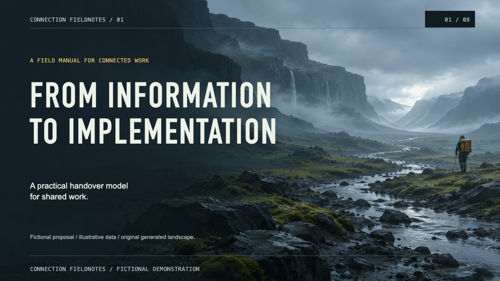
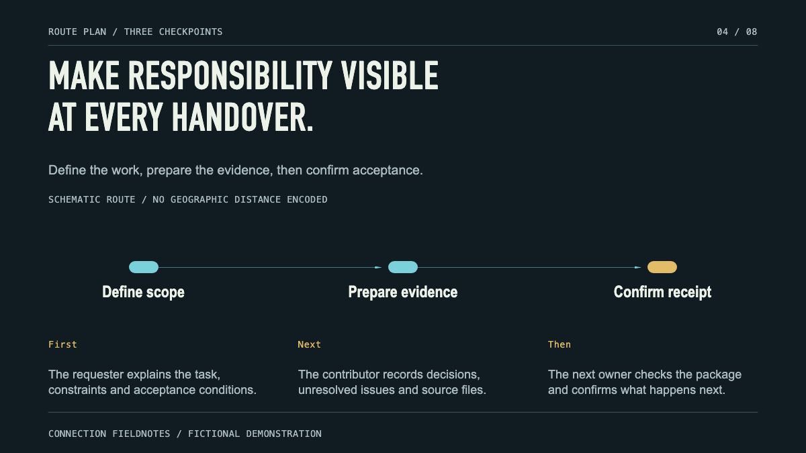
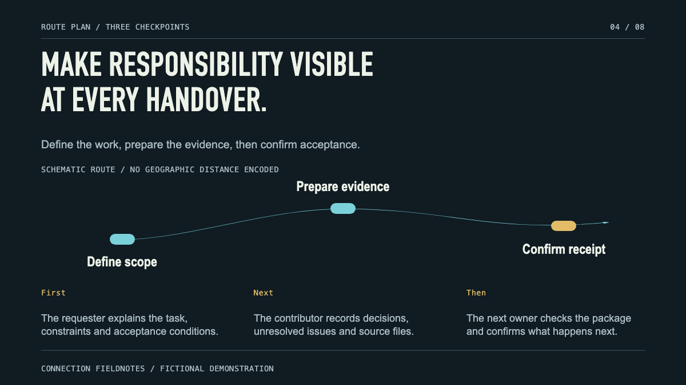
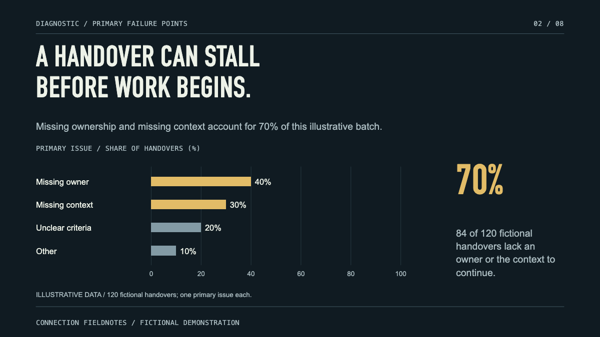
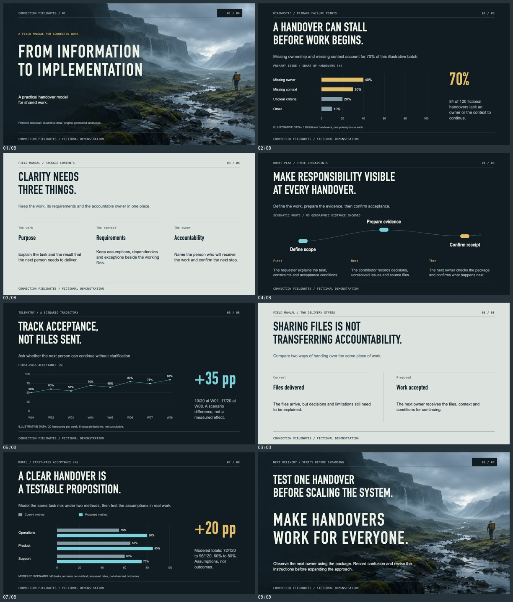

# Story: a Death Stranding-inspired handover proposal

**English** | [简体中文](death-stranding.md)

[Back to README](../../README.md) · [Usage guide](../usage.en.md)

The user had an English handover proposal, wanted quantitative exhibits, and asked for the environmental mood and connection metaphor of Death Stranding. The proposal explains how another person can continue the work; the visual reference supports that story.

*Cover example: the landscape was independently generated; titles and metadata were laid out separately. All images below are actual HTML renders from the historical case. Both language editions share the original English slides, with localized captions.*

## Start with the new two-choice entry

The following prompt uses the updated workflow. **The two-choice entry is a new addition, not a claim about how the historical case was run.**

> Use $ppt-design-system to make this English handover manuscript in a Death Stranding-inspired direction. I have no template. Inspect actual public references, then let me choose direct IP images or independent assets with similar visual qualities. Render 2–3 distinct directions using identical cover and content-page copy, show sources and trade-offs, and wait for my selection before making the full deck. Preserve numbers and caveats, and distinguish illustrative inputs from observed results.

**Choice 1: imagery.** Direct images can preserve a specific work's identity. Independent similar-style assets can carry landscape scale, fog, lighting or material qualities. They may be sourced photos or original generated artwork; similar-style does not automatically mean AI generation. Viewing official references does not automatically place those images in the final deck.

**Choice 2: visual direction.** Render the same cover and representative content page in each direction. Compare type hierarchy, composition, density, graphic rhythm and image treatment. Let the observed reference shape the options rather than assuming every game-inspired deck needs a dark HUD. Select one direction or combine them with explicit scope, such as “A overall, B only for data pages.”

Keep the selected image approach consistent across candidates. If the user chooses independent similar-style assets, do not quietly put official stills in another candidate. Reuse a concrete reference or prior choice without asking again.

## What the historical case actually did

The visual research used environmental and bridge imagery on the [official PlayStation page](https://www.playstation.com/en-us/games/death-stranding/). Observed cues included landscape scale, fog, cyan connections and amber cargo. A separately generated original landscape carried the final atmosphere; official images were reference-only, not the final background.

Fonts, metadata strips, exact colors, charts and whole-page layouts were design extensions for this presentation, not measurements of the game interface. Editable text and business graphics stayed separate from background artwork. This was a visually inspired presentation, not an official game template or brand specification.

The initial reference-derived pack was frozen before strict matching. Ranking, trend and modeled-scenario relationships were missing and were added in a production copy. The original pack remained intact. For the process page, step-rail and milestone-path drawings were rendered with identical copy. The route drawing was chosen to support the connection-across-terrain metaphor while retaining the three-stage reading order.

### The same process, two drawings

| Aligned step rail | Milestone path · selected for this case |
| --- | --- |
|  |  |

*Both use the same define scope, prepare evidence and confirm receipt copy. The rail emphasizes alignment and sequence; the path carries the connection-across-terrain metaphor into the structure. The choice considers reference fit and reading order, beyond color changes. Click an image for a larger view.*

## How the eight pages worked

| Page | Story task | Composition and rationale |
| --- | --- | --- |
| 1 | From information to implementation | Low-density landscape opening; connection as metaphor |
| 2 | A handover can stall before work begins | Ranked bars and a separate 70% takeaway |
| 3 | Clarity needs three things | Light three-column page: Purpose / Requirements / Accountability |
| 4 | Make responsibility visible at every handover | Three waypoints: define scope, prepare evidence, confirm receipt |
| 5 | Track acceptance, not files sent | Eight-week line retains fluctuations; endpoint difference +35 percentage points |
| 6 | Sharing files is not transferring accountability | Two-column comparison of files delivered and work accepted |
| 7 | A clear handover is a testable proposition | Grouped bars on the same scale; modeled difference +20 percentage points |
| 8 | Test one handover before scaling the system | Landscape and action statement; test before expanding |

All three datasets were fictional inputs: a 120-handover issue distribution of 40/30/20/10%; eight independent weekly batches of 20 with acceptance starting at 50% and ending at 85%; and two assumed methods with the same task mix totaling 60% and 80%. They do not establish effectiveness. Percentage-point differences are not relative growth, and independent weekly batches are not a cumulative cohort.

*Data-page example: the dark field, condensed title and restrained accents carry the visual language, while bars share a zero baseline. The 70% callout is separate summary text, and the page labels its data as fictional. A screenshot shows appearance, not data-linked editability.*

Expand the complete eight-page overview

*Use the overview to compare light/dark rhythm and information density; the individual examples above show readable page details.*

## Evidence and standard-export limits

The historical case checked browser layout and inheritance for eight pages and both process candidates, plus HTML text editing, dragging, offline saving and reopening. All eight PDF pages received text and render checks. Repeating the same reviewed mapping produced identical static output; this does not prove that independent models select the same layouts.

Standard export supplies native text, pictures, basic shapes, curves and groups. **The case's three data-linked PowerPoint charts came from separate production postprocessing, which is not integrated into the public Skill.** In a Mac PowerPoint test copy, changing one value from 40 to 41 survived saving and reopening; the final retained the original data. This is not evidence for every chart, Windows or other font environments. Changing HTML numbers does not automatically rescale marks, and separate metric callouts require manual updates.

This public story shares the method, page roles, example images and evidence limits, not original game images, private inputs, deck files or test copies. Death Stranding identifies a visual reference, without implying official affiliation or permission. Use assets obtained under their source conditions.
