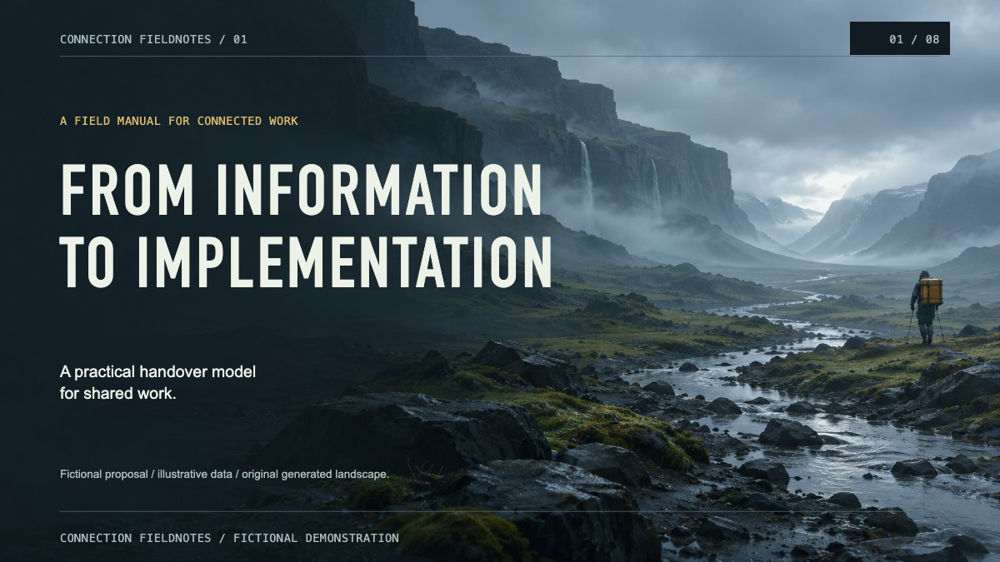
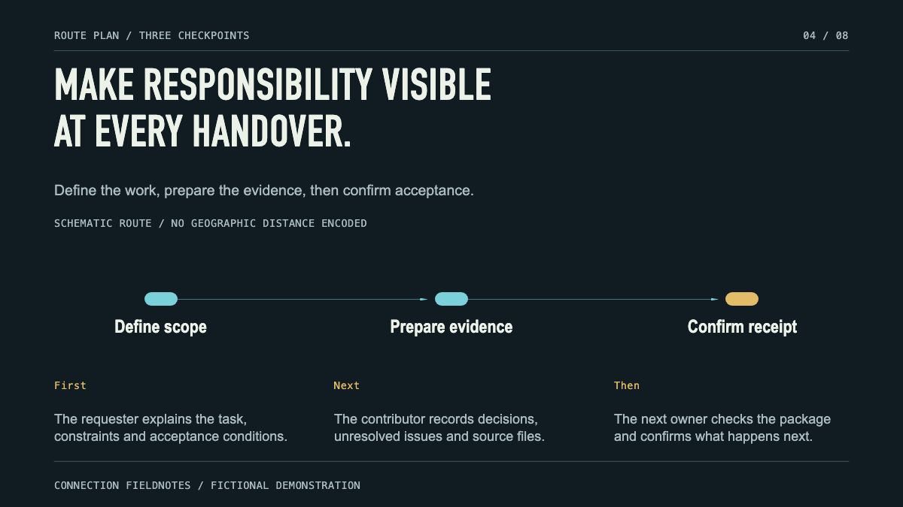
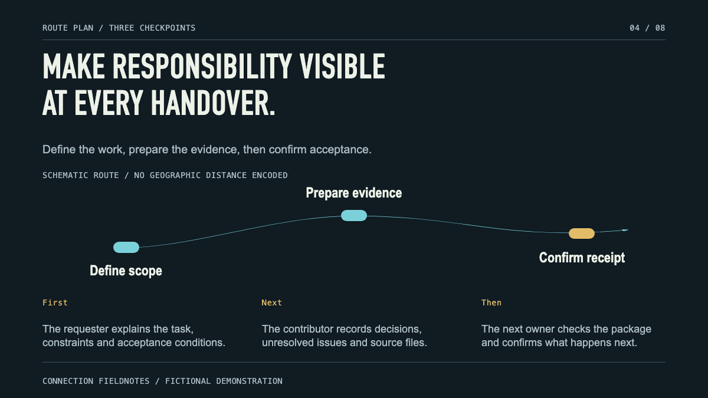
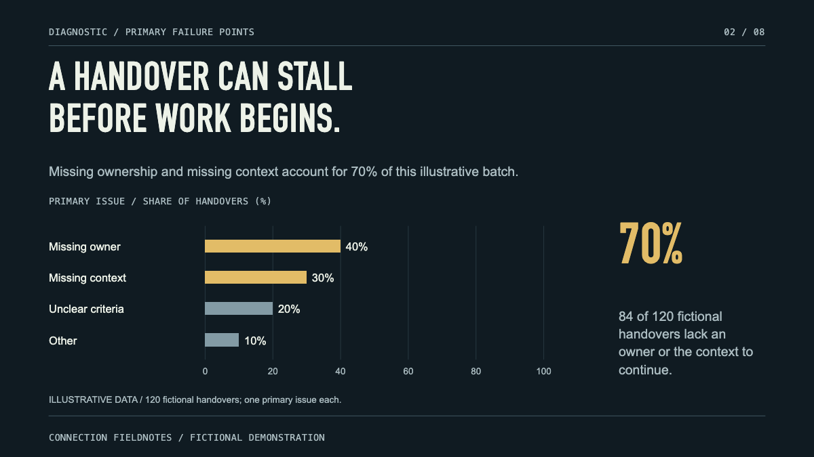
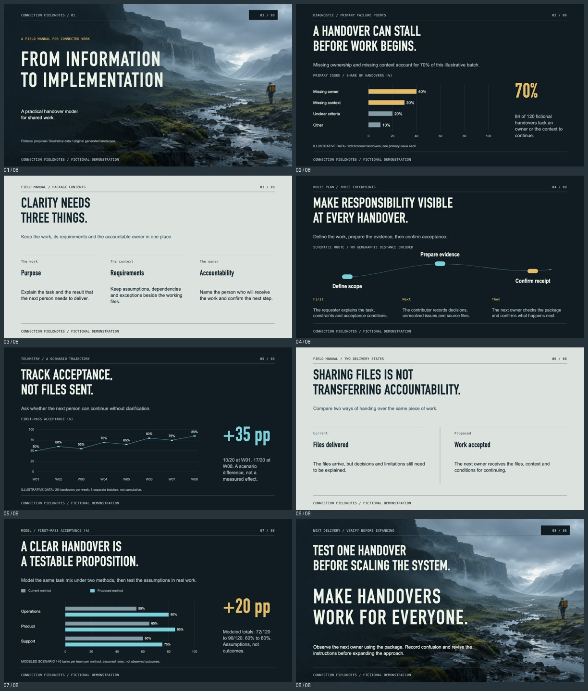

# 使用故事：把交接提案做成死亡搁浅风格

[English](death-stranding.en.md) | **简体中文**

[返回 README](../../README.zh-CN.md) · [操作指南](../usage.md)

用户有一份英文交接提案，希望加入数据展示，并借用《死亡搁浅》的环境感和连接隐喻。任务是让下一位接手者能够继续工作，游戏风格负责视觉表达，文稿负责业务含义。

*封面示例：景观图为独立生成，标题与元数据为单独排版。以下均为历史案例的 HTML 实际渲染截图；原稿是英文，中英文故事共用同一组示例，说明文字分别本地化。*

## 新版从两个选择开始

下面是现在可直接使用的提示词。**两步选择是新版补充的入口，不是对历史案例过程的追述。**

> 用 $ppt-design-system，把这份英文交接稿做成死亡搁浅风格。我没有具体模板。请先查看真实公开参考，让我选择直接使用原 IP 图片，还是用相似视觉语言的独立素材。再用同一份封面和内容页文案渲染 2–3 个不同方向，附参考来源与取舍，等我选定后再做完整演示。保留文稿中的数字和限制条件，区分示例数据与实测结果。

**第一处选择：素材。** 原作图片适合明确需要该作品身份的画面；相似风格素材则迁移荒野尺度、雾气、光线或材质。后者可以来自搜图，也可以是原创生成，不自动等于生图。官方参考可用于观察，但不因此自动进入成稿。

**第二处选择：视觉方向。** 用同稿生成封面和一张代表内容页，再比较字体层级、构图、密度、图形节奏和图片处理。方向来自本次实际参考，不能预先固定成“游戏一定是暗色 HUD”。用户可以选择一个，也可指定「A 主导整体，B 只用于数据页」。

如果选「相似风格独立素材」，后续候选和成稿都遵守该素材方式；不能在另一个候选里悄悄换成官方剧照。已有明确参考和选择时不重复问。

## 历史案例实际怎么完成

参考来自 [PlayStation 官方页面](https://www.playstation.com/en-us/games/death-stranding/)的环境与桥梁画面。观察荒野尺度、雾气、青色连接与琥珀色货物等线索。最终氛围图为独立生成的原创景观，官方图只用于参考，不是成稿背景。

字体、元数据栏、精确色值、图表和整页排版均为此次适配设计，未宣称从游戏界面测得。文字、业务图形与背景分离，避免把可改内容烘焙进图片。这个例子是游戏视觉启发的演示，不是游戏模板或官方品牌规范。

冻结初始参考衍生包后，先严格匹配。排名、趋势和假设情景三个关系出现缺口，在生产副本补足；原包保留。流程页把 step-rail 与 milestone-path 放入同一文案实际渲染比较，选路径版呼应跨地形连接，同时保住三阶段顺序。

### 同一流程，两种画法

| 直线阶段轨道 | 路径式节点 · 本例选用 |
| --- | --- |
|  |  |

*两张图使用相同的定义范围、准备证据、确认接收文案。左图强调平齐与顺序；右图让“跨地形连接”的隐喻进入结构。选择依据是参考契合度与阅读顺序，不只是换颜色。点击图片可查看大图。*

## 八页如何分工

| 页 | 文稿任务 | 构图与判断 |
| --- | --- | --- |
| 1 | From information to implementation | 低密度景观开场，连接作为隐喻 |
| 2 | A handover can stall before work begins | 条形图排序问题，独立的 70% 结论 |
| 3 | Clarity needs three things | 浅色三栏：Purpose / Requirements / Accountability |
| 4 | Make responsibility visible at every handover | 路径与三节点：定义范围、准备证据、确认接收 |
| 5 | Track acceptance, not files sent | 八周折线保留波动，端点差 +35 个百分点 |
| 6 | Sharing files is not transferring accountability | 双栏比较“文件送达”和“工作被接收” |
| 7 | A clear handover is a testable proposition | 同尺度分组条形图，假设情景差 +20 个百分点 |
| 8 | Test one handover before scaling the system | 景观与行动句收尾，强调先验证再扩展 |

三组数据都是虚构输入：120 个交接的问题分布为 40/30/20/10%；八个独立周批次每周 20 个，首尾通过率 50%→85%；同任务结构的两方法假设总通过率 60%→80%。这些数字不证明流程有效，百分点不能写成相对增幅，独立周批次不能当成累计队列。

*数据页示例：保留暗色场、窄体标题与少量强调色，用同一零点的条形表达数量关系。右侧 70% 是独立摘要文字；图中明确标记虚构数据。截图展示视觉结果，不证明数据联动能力。*

展开查看完整八页缩略图

*总览用于比较整套明暗节奏与信息密度；具体文字请查看上方单页示例。*

## 已验证什么，标准 Skill 提供什么

历史案例在本机验证了 8 页与两个流程候选的浏览器排版、继承检查，以及 HTML 改字、拖动、离线保存重开；8 页 PDF 完成文本与渲染检查。同一已审映射重复生成结果一致，不能据此声称不同模型会选出相同版式。

标准导出提供原生文字、图片、基础形状、曲线与组合。**案例里的三个数据联动 PowerPoint 图表来自单独生产后处理，未集成到公开 Skill。** 该案例的 Mac PowerPoint 测试副本把一个值 40 改为 41 后保存重开，正式稿保留原数据。此检查不代表所有图表、Windows 或其他字体环境已验证；HTML 里改数字也不会自动重算图形，独立指标文字需手动同步。

这份公开故事包含方法、页面分工、示例配图和证据边界，不提供原作图片、私人输入、演示文件或测试副本。文中的《死亡搁浅》仅说明参考方向，不表示官方合作或授权。请按来源条件使用自己取得的素材。
